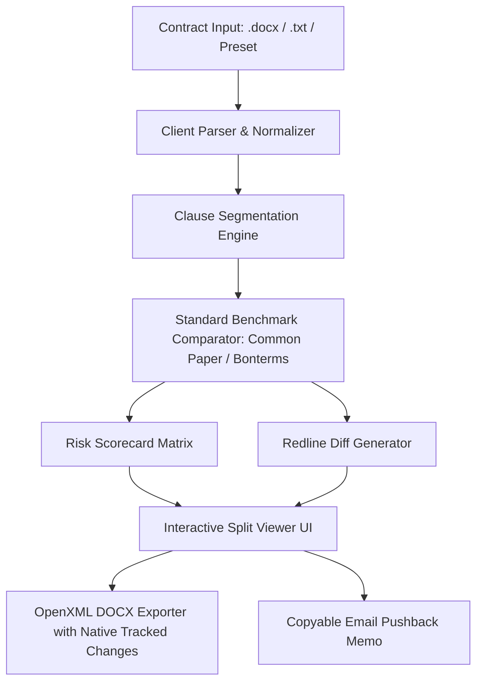

# Redline : Technical Architecture

## System Overview
Redline is architected as a pure client-side application built on **Next.js 14 (App Router) + TypeScript + Tailwind CSS**. It conforms to the **Raphie Static Hosting Doctrine** (zero persistent servers, deployable to static hosts or serverless edge without runtime container overhead).

## Component Breakdown

### 1. Document Ingestion & Parser (`src/lib/parser/`)
- Accepts `.docx`, `.txt`, and raw text pastes.
- Uses `mammoth.js` to extract structured document AST (paragraphs, headings, bold/emphasis runs).
- Normalizes contract numbering, section prefixes (`Section 8.1`, `8(a)`, `ARTICLE IV`), and clause boundaries.

### 2. Clause Segmentation & Classification (`src/lib/engine/clauseSegmenter.ts`)
- Evaluates contract text into distinct semantic legal clauses using regex-based pattern matching and keyword heuristics:
  - *Limitation of Liability*: `limitation of liability`, `aggregate liability`, `consequential damages`, `indirect damages`.
  - *Indemnification*: `indemnify`, `hold harmless`, `defend against`, `third-party claims`.
  - *Term & Renewal*: `renewal term`, `automatic renewal`, `prior written notice`, `days before expiration`.
  - *IP & Feedback*: `work made for hire`, `intellectual property rights`, `feedback`, `unrestricted license`.
  - *Governing Law*: `governed by the laws of`, `jurisdiction`, `exclusive venue`, `arbitration`.
  - *Warranties & Disclaimers*: `as is`, `warranty disclaimer`, `merchantability`, `fitness for a particular purpose`.

### 3. Standards Comparator & Risk Auditor (`src/lib/standards/` & `src/lib/engine/riskAuditor.ts`)
- Compares extracted clauses against the **Common Paper Cloud Service Agreement (Standard v1.0)** and **Common Paper Mutual NDA**.
- Detects asymmetric risk markers:
  - Liability caps below 12 months fees paid, or asymmetric caps where Customer has unlimited liability while Vendor is capped at \$100 or 1 month fees.
  - Absence of reciprocal indemnification for vendor IP infringement.
  - Auto-renewal cancellation windows $>30$ days (e.g. 60 or 90 days required notice).
  - Unilateral feedback clauses granting perpetual, royalty-free exclusive IP transfer to the vendor.
- Assigns severity: `CRITICAL` (red), `HIGH` (amber), `STANDARD` (green).

### 4. Redline Diff Generator (`src/lib/engine/redlineGenerator.ts`)
- For each flagged clause, pairs the predatory text with an open-standard Common Paper fallback clause.
- Computes character and word-level diff segments (`delete`, `insert`, `equal`).

### 5. Native Tracked-Change DOCX Exporter (`src/lib/docx/docxExporter.ts`)
- Uses the `docx` library (OpenXML specification) to generate `.docx` files.
- Emits native tracked revisions:
  - `<w:del>` runs for removed predatory clauses.
  - `<w:ins>` runs for inserted Common Paper fallback clauses.
  - Author attribute set to `"Redline Legal Auditor"` with ISO 8601 timestamps.
  - Embedded Word comment bubbles detailing the statutory and commercial risk rationale.

## Tech Stack & Dependencies
- **Framework:** Next.js 14 / React 18 / TypeScript
- **Styling:** Tailwind CSS + Semantic Color Tokens
- **Icons:** `lucide-react`
- **Document Processing:** `docx` (OpenXML document generation), `mammoth` (DOCX extraction), `diff` (word-level diffing)
- **Deployment:** Vercel / Netlify / GitHub Pages (100% static export or Edge functions)
