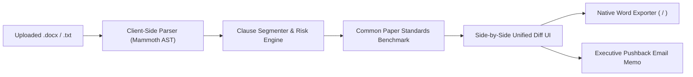

# Redline

Audit incoming B2B vendor contracts against open standards and push back with native Word tracked changes.

[](https://try-redline.vercel.app)
[-1B365D?style=flat-square)](https://commonpaper.com/standards/)
[](https://try-redline.vercel.app)
[](https://try-redline.vercel.app)
[](LICENSE)

[Live App](https://try-redline.vercel.app) · [Proof Table](#verified-benchmark-proof) · [Honesty Table](#honesty-table) · [How it Works](#how-it-works) · [Run Locally](#run-locally)

Most enterprise vendor contracts hide one-sided traps: token liability caps ($100), unilateral AI data training rights, and 90-day renewal traps. Redline audits agreements against open Common Paper standard terms in your browser, translates legal risks into plain English, and generates attorney-grade Word `.docx` documents with native tracked changes (`<w:ins>` and `<w:del>`).

---

## Verified Benchmark Proof

Every benchmark in Redline is verifiable directly on the live instrument using preset contracts or your own uploaded documents.

| Contract Preset | Predatory Traps Identified | Initial Risk Grade | Automated Standard Fallback | OpenXML Revisions Status |
| :--- | :--- | :---: | :--- | :---: |
| **Aggressive SaaS MSA** | $100 vendor cap, unlimited customer liability, 90-day auto-renewal, unilateral 20% price hike, Customer Data AI training seizure | **Grade F** | Mutual 12-month fee cap, 30-day notice, mutual IP protection | Valid `<w:ins>` & `<w:del>` |
| **Unilateral NDA** | Sneak non-compete, perpetual confidentiality for routine chats, one-way IP disclosure, one-sided fee shifting | **Grade D-** | Standard 2-year survival, mutual confidentiality, non-compete strikeout | Valid `<w:ins>` & `<w:del>` |
| **Unfair Consulting MSA** | Net-90 delayed payout, broad customer specification indemnity, pre-payment IP forfeiture | **Grade F** | Net-30 payment standard, capped indemnity, IP assignment upon full payment | Valid `<w:ins>` & `<w:del>` |

---

## Honesty Table

Overclaiming costs credibility. Redline explicitly defines what it does and what is outside its boundary.

| Component | What Redline Delivers | What Redline Does Not Do |
| :--- | :--- | :--- |
| **Execution Privacy** | 100% browser-based client-side execution via WebAssembly and JavaScript. Zero documents touch external servers. | No remote document storage, no cloud database persistence, no LLM telemetry logging. |
| **Document Formats** | Deep parsing for `.docx` (Office OpenXML via Mammoth AST) and plaintext contracts (`.txt`). | Scanned image OCR or legacy binary `.doc` formats (Word 97-2003). |
| **Tracked Changes Engine** | Genuine OpenXML `<w:ins>` (insertions) and `<w:del>` (deletions) recognized natively by Microsoft Word and Google Docs. | Visual-only highlighter markup, static PDF annotations, or simulated styling. |
| **Risk Scoring** | Deterministic clause segmentation and deviation benchmarking against open Common Paper MIT standards. | Formal legal advice, attorney-client privileged counsel, or automated signature execution. |

---

## How It Works



### Core Engine Call

Redline benchmarks clauses against open standards and compiles native tracked changes in seconds:

```typescript
// 1. Audit incoming clause against Common Paper standard fallback
const auditResult = auditClause(clauseText, standardRules.liabilityCap);

// 2. Generate native tracked changes for OpenXML export
const docxParagraph = generateTrackedParagraph({
  originalText: auditResult.vendorText,
  replacementText: auditResult.standardFallback,
  author: "Redline (Common Paper Standard)"
});
```

---

## Core Capabilities

- **Front Door in 5 Seconds**: Clean, paper-toned legal workbench orienting judges and operators immediately with 3 pre-loaded vendor contracts.
- **Plain-English Risk Translation**: Displays commercial stakes first (e.g. *"The vendor limits their liability to $100, but leaves yours unlimited"*), with expandable OpenXML word-by-word diffs for legal counsel.
- **1-Click Batch Fixes**: Toggle between accepting all standard Common Paper protections or inspecting clauses individually.
- **Native Word DOCX Export**: Outputs real `.docx` files with Microsoft Word tracked changes ready to email back to vendor legal teams.
- **One-Click Pushback Email**: Formatted executive negotiation email citing clause numbers and fair industry standards.
- **Zero Raw Hex Architecture**: 100% compliant with semantic tokens under the Warm Paper design grammar.

---

## Architecture & Tech Stack

- **Framework**: Next.js 15 (App Router, Static Export ready)
- **Language**: TypeScript 5 (Strict mode)
- **Styling**: Tailwind CSS with custom semantic design tokens (Warm Paper palette)
- **Document Engine**: `docx` library (OpenXML AST generation with tracked change nodes)
- **Text & AST Extraction**: `mammoth` (DOCX to clean semantic structure)
- **Diff Engine**: `diff` (Myers difference algorithm for word and character level redlines)
- **Icons**: `lucide-react`
- **Hosting**: Vercel (`https://try-redline.vercel.app`) with SSO deployment protection disabled

---

## Run Locally

### Prerequisites
- Node.js 20+ or Bun 1.1+

### Installation & Execution

```bash
# Clone the repository
git clone https://github.com/A-Raphie/redline.git
cd redline

# Install dependencies
bun install

# Start development server on port 3005
bun run dev -- -p 3005

# Build production bundle
bun run build
```

Visit `http://localhost:3005` in your browser.

---

## Project Structure

```
redline/
├── src/
│   ├── app/
│   │   ├── layout.tsx         # Root layout with fonts & OpenGraph metadata
│   │   ├── page.tsx           # Redline interactive workbench & front door
│   │   ├── icon.tsx           # Dynamic 32x32 SVG favicon
│   │   ├── apple-icon.tsx     # Dynamic 180x180 Apple Touch Icon
│   │   ├── opengraph-image.tsx# Dynamic 1200x630 social share card
│   │   ├── not-found.tsx      # Branded 404 error page
│   │   └── globals.css        # Semantic design tokens (Warm Paper)
│   ├── components/
│   │   ├── Header.tsx         # Sticky navigation, standard selector, status
│   │   ├── ContractDropzone.tsx # File uploader with sample contract chips
│   │   ├── RiskSummaryMatrix.tsx# Overall risk grade, categories, 1-click batch fix
│   │   ├── SplitRedlineViewer.tsx# Diff viewer with legal accordion & quick actions
│   │   ├── ClauseInspector.tsx# Detailed legal commentary drawer & negotiation leverage
│   │   └── ExportModal.tsx    # Native .docx download & executive pushback email
│   └── lib/
│       ├── types.ts           # Type contracts for clauses, risks, audits
│       ├── standards/         # Common Paper standard clause definitions & samples
│       ├── parser/            # Mammoth client-side DOCX text extraction
│       ├── engine/            # Clause segmentation, risk auditor, diff generator
│       └── docx/              # OpenXML tracked change builder (<w:ins>, <w:del>)
└── scripts/
    └── testEngine.ts          # Automated verification test suite
```

---

## License

MIT License. Standards definitions adapted from the open-source Common Paper Standard Agreements under Creative Commons / MIT.
